<p align="center">
  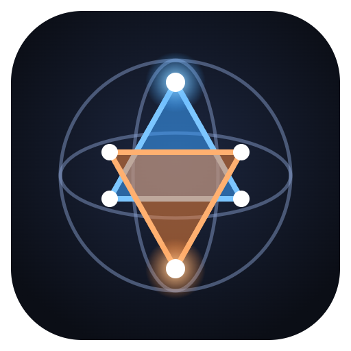
</p>

<h1 align="center">SPHAIRON</h1>
<p align="center"><b>Polyharmonic Geometry</b><br>
IsodaLab<br>
<i>A workstation for harmony, geometry and polyharmony.<br>
Free advanced music production software, created for the global creative community.</i></p>

<p align="center">
  <a href="https://github.com/isodalab/sphairon/releases/tag/v1.2.1"><b>Download 1.2.1</b></a> ·
  <a href="#install-on-windows">Install on Windows</a> ·
  <a href="#install-on-macos">Install on macOS</a> ·
  <a href="#install-on-linux">Install on Linux</a> ·
  <a href="#tutorials">Tutorials</a> ·
  <a href="#concepts">Concepts</a>
</p>

<p align="center">
  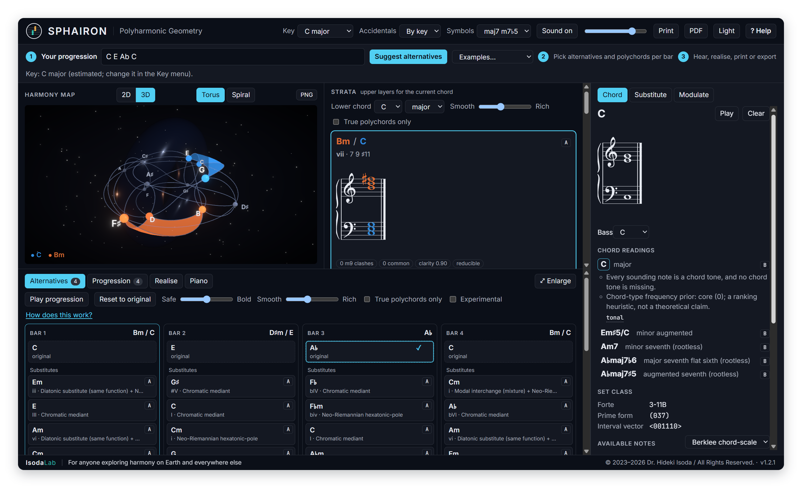
</p>

**SPHAIRON is free, standalone software for composers, arrangers, theorists and students who want to explore harmony beyond the usual chords: the chromatic and geometric harmony of contemporary composition, jazz harmony, and above all polyharmony, two chords sounding together in separate registers.** Type a chord progression and SPHAIRON suggests, for every bar, substitute chords and polychords, each with its reasons, its sources and a measure of how smooth or rich it sounds. Hear the result part-written for voices, for orchestra, for piano with a moving bass, or under a counterpoint melody. See every chord in 3D and 2D harmonic geometry. Print it, or export it as PDF, SVG, PNG, MIDI or MusicXML for your notation program.

It runs on **Windows**, **macOS** (Apple silicon) and **Linux**, with the same features on all three, and works completely offline.

## Download

| Platform | Package | Requirements |
|---|---|---|
| **Windows** | [IsodaLab-SPHAIRON-1.2.1-Windows.zip](https://github.com/isodalab/sphairon/releases/download/v1.2.1/IsodaLab-SPHAIRON-1.2.1-Windows.zip) | 64-bit Windows 10 or 11 |
| **macOS** | [IsodaLab-SPHAIRON-1.2.1-macOS-AppleSilicon.dmg](https://github.com/isodalab/sphairon/releases/download/v1.2.1/IsodaLab-SPHAIRON-1.2.1-macOS-AppleSilicon.dmg) | Mac with Apple silicon (M1 or later), macOS 12 or later |
| **Linux** | [IsodaLab-SPHAIRON-1.2.1-Linux-x86_64.zip](https://github.com/isodalab/sphairon/releases/download/v1.2.1/IsodaLab-SPHAIRON-1.2.1-Linux-x86_64.zip) | 64-bit Linux (x86_64) with a desktop: Ubuntu 22.04+, Debian 12, Fedora 39+ or similar |

Every package contains the app, the **SPHAIRON Quick Start** guide (PDF) and the license. [SHA256SUMS.txt](https://github.com/isodalab/sphairon/releases/download/v1.2.1/SHA256SUMS.txt) lists the checksums. SPHAIRON is a standalone app: there is no installer, no account and no license key, and nothing else to install. The full guide is inside the app: click **? Help** or press **F1**.

## What it does

- **Alternatives for every chord.** Type a progression (`C E Ab C`, `Dm7 G7 Cmaj7 A7`, slash chords such as `C/E` included) and get, for each bar, substitute chords read in context (neo-Riemannian moves, chromatic mediants and hexatonic poles, modal interchange, augmented sixths, tritone substitution, diatonic substitutes and more) and polychords. Click one to use it and hear it in context; every suggestion says why, with its sources.
- **41 examples to start from.** Contemporary techniques first (hexatonic and octatonic cycles, hexatonic poles, chromatic mediants, dominants a minor third apart, planing, pedals, Lydian colour), then jazz (ii–V–I, tritone and backdoor substitution, rhythm changes, Coltrane changes, modal), classical and Romantic, and pop. SPHAIRON suggests the key from the chords; you can change it at any time.
- **Polyharmony design (Strata).** For any chord, upper layers ranked from smooth to rich: upper-structure triads, true polychords, quartal layers. Each shows its tensions, half-step clashes, common tones and a clarity measure, on the staff and in 3D. Add an upper layer to a bar, replace it or remove it.
- **Whole-progression strategies.** Give a progression an upper layer in one move: planing, pedal, bitonal, tritone, mode-bound or neo-Riemannian (and an experimental phasing strategy).
- **Automatic part writing.** The progression arranged for four voices, plus three for an upper layer, under the common-practice rules of voice leading: complete chords (only the fifth may be left out, so a seventh chord keeps its seventh), no parallel fifths or octaves, no crossing, close spacing, tendency tones resolved, correct doubling. The result is checked again and the check is shown. Alternative arrangements (melody from the 3rd, 5th or root; close or open position; a smoother bass with inversions) are one click away.
- **Play from anywhere, and watch it.** Click a note or bar to play from there; the harmony map follows the music in real time.
- **Hear it in music.** Orchestration built on the arrangement (every instrument plays one voice, inside its practical range), playable piano figures, moving bass lines (passing, pedal, arpeggio, walking and more, each in the bass register of its instrument) and a counterpoint melody with alternative lines.
- **Analysis.** Chord readings, set class (Forte name, prime form, interval vector), available notes and avoid notes (Berklee and Messiaen lenses), Roman numerals, and modulation routes to any key with both readings.
- **Harmonic geometry.** A 3D torus Tonnetz and a spiral of fifths that show both layers of a polychord; a 2D pitch-class clock, circle of fifths and Tonnetz for building chords by clicking.
- **Print and export.** An A4 sheet (print or PDF) with notation and analysis; SVG and high-resolution PNG notation; MIDI with General MIDI instruments; MusicXML for Dorico, Finale, MuseScore and Sibelius. Exported scores are black and white.
- **MIDI keyboard.** Play a chord and SPHAIRON reads it at once.

<p align="center">
  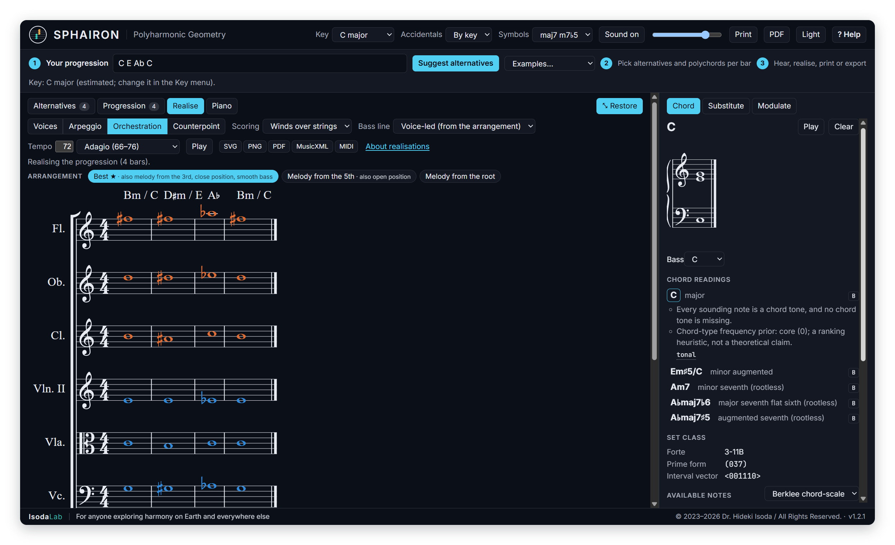
</p>

## Install on Windows

1. **Unblock the download.** Right-click the ZIP → **Properties**. At the bottom of the *General* tab, tick **Unblock**, then click **OK**. Do this *before* extracting.
2. **Extract.** Right-click the ZIP → **Extract All…**, and put the folder wherever you like (for example in *Documents* or *C:\Program Files*).
3. **Run `SPHAIRON.exe`** inside the folder. Keep the other files next to it: they are part of the program. Pin it to the taskbar or Start if you like.

<details>
<summary><b>If Windows or your browser blocks it</b></summary>

SPHAIRON is free and isn't code-signed with a paid certificate, so Windows treats it as *unrecognized*. It contains no network code and collects no data.

| What you see | What to do |
|---|---|
| **Edge:** "…isn't commonly downloaded" | Hover over the download, click **…** → **Keep** → **Show more** → **Keep anyway**. |
| **Chrome:** "Suspicious download" | Click **Keep** in the downloads list. |
| **"Windows protected your PC"** (SmartScreen) when you run it | Click **More info**, then **Run anyway**. Windows asks only the first time. |
| Your antivirus quarantines `SPHAIRON.exe` | Restore it and add an exception for it. |
| **Smart App Control** (Windows 11) refuses to run it | Smart App Control can block unsigned apps and has no override. The only way around it is to switch it off under *Windows Security → App & browser control → Smart App Control settings*. On many Windows 11 versions it can't be switched back on without resetting Windows, so weigh that before you do it. |

</details>

## Install on macOS

1. **Download** `IsodaLab-SPHAIRON-1.2.1-macOS-AppleSilicon.dmg` and double-click it.
2. **Drag `SPHAIRON.app` to your Applications folder.** The Quick Start guide and the license are in the same window.
3. **Open it.** The first time, macOS shows an alert saying *"SPHAIRON" Not Opened*. That's expected: SPHAIRON is free and isn't notarized with a paid Apple Developer ID. Click **Done**, not *Move to Trash*.
4. **Open System Settings → Privacy & Security** and scroll down to **Security**. Next to *"SPHAIRON" was blocked to protect your Mac*, click **Open Anyway**. Enter your password (or use Touch ID) and confirm with **Open Anyway**. macOS remembers this: from now on SPHAIRON opens normally.

<details>
<summary><b>If macOS says the app is damaged</b></summary>

Some browsers and download tools mark the file so strictly that macOS reports it as *damaged* instead of offering *Open Anyway*. Open **Terminal** and run:

```bash
xattr -dr com.apple.quarantine /Applications/SPHAIRON.app
```

Then open SPHAIRON again.

</details>

## Install on Linux

1. **Extract** the download with your file manager, or in a terminal:

   ```bash
   unzip IsodaLab-SPHAIRON-1.2.1-Linux-x86_64.zip -d SPHAIRON
   ```

2. **Run it**, or add it to your applications menu:

   ```bash
   cd SPHAIRON
   ./SPHAIRON            # run it from here
   ./install.sh          # or: install for this user (~/.local/bin and the menu)
   ```

   No root password is needed. If your file manager dropped the executable bit, run `chmod +x SPHAIRON sphairon install.sh` first. `./SPHAIRON --version` prints the version and the copyright notice; `./install.sh --uninstall` removes the menu entry.

<details>
<summary><b>About the Chromium sandbox on Linux</b></summary>

SPHAIRON is built on Electron (Chromium). Chromium's process sandbox needs either a helper owned by root or *user namespaces*, which some distributions (Ubuntu 24.04 and later) restrict. A ZIP can't carry a root-owned helper, so the `SPHAIRON` launcher starts the app without that sandbox when neither is available. SPHAIRON makes no network connections, so it handles no untrusted web content. To keep the sandbox on instead, run once in the SPHAIRON folder:

```bash
sudo chown root:root chrome-sandbox && sudo chmod 4755 chrome-sandbox
```

</details>

## Tutorials

Shortcuts are written for Windows and Linux; on a Mac, use **Cmd** where they say Ctrl. Every control can also be reached with **Tab** and the arrow keys.

### The workspace

<p align="center">
  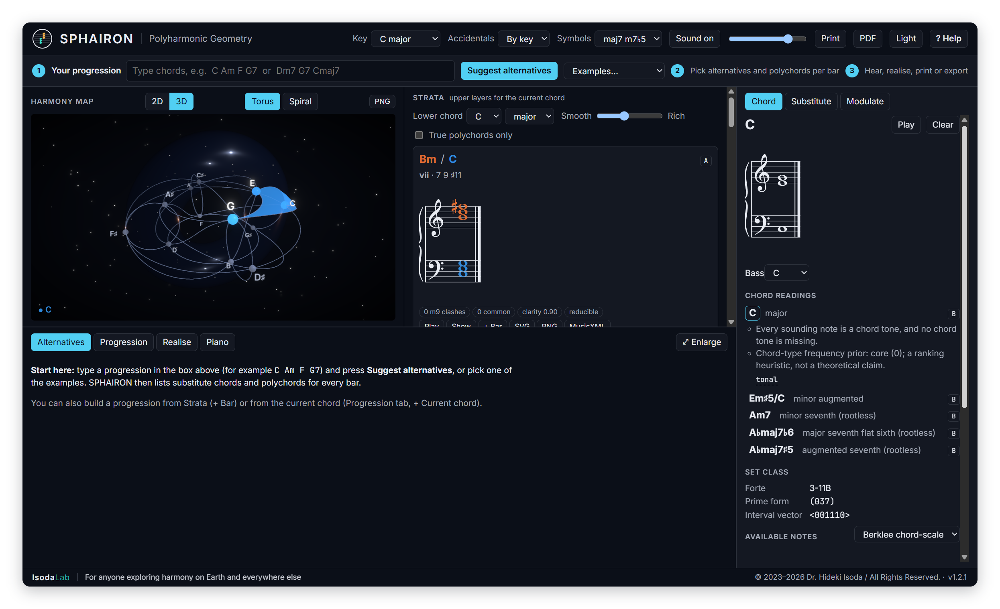
</p>

- **Top:** your progression (step 1), the key, accidental spelling, chord-symbol style, sound, Print, PDF, theme and **? Help**.
- **Harmony map** (left): 3D (torus Tonnetz, spiral of fifths) or 2D (pitch-class clock, circle of fifths, Tonnetz). Drag to turn the 3D view, scroll to zoom. In 2D, click notes to build a chord.
- **Strata** (middle): upper layers for the current chord.
- **Chord · Substitute · Modulate** (right): the current chord analysed; chords that can replace it; routes to another key.
- **Alternatives · Progression · Realise · Piano** (bottom): your progression and what you can do with it. **⤢ Enlarge** gives this panel the full height.

### Tutorial 1: Reharmonize a progression

1. Type `C E Ab C` (major-third mediants) in **Your progression** and press **Suggest alternatives** (or Enter). You can also pick one of 41 progressions from **Examples…**: contemporary, jazz, classical and pop. SPHAIRON suggests the key from the chords (shown below the box); change it in the **Key** menu if you hear it otherwise.
2. The **Alternatives** tab shows one column per bar: the chord as you entered it, then **Substitutes**, then **Polychords**. Each option shows its Roman numeral, the rule or structure behind it, and its tier: **A** scholarly, **B** pedagogy, **C** experimental (off unless *Experimental* is ticked).

   <p align="center">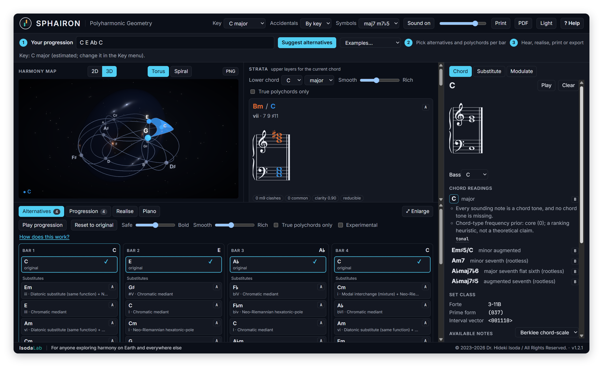</p>

3. **Click an option** to use it. You hear it at once, the column header shows the new chord, and the panel below explains *why* it works, with its sources and the notation of the bars around it. **Play in context** plays it with its neighbours.
4. Move **Safe ↔ Bold** to prefer familiar or adventurous substitutes, and **Smooth ↔ Rich** to prefer polychords with few or more half-step clashes. **True polychords only** hides upper layers that merely form one bigger chord with the lower layer.
5. **Play progression** plays the whole progression; **Reset to original** puts every bar back.

### Tutorial 2: Design polychords with Strata and the 3D view

1. Click a bar's header in the Alternatives grid (or a bar in the Progression tab): it becomes the **current chord**, and Strata, the maps and the Chord tab follow it.
2. **Strata** lists upper layers for that chord, ranked by the Smooth–Rich slider. Each card shows the polychord on a grand staff (upper layer orange, lower layer blue), its structure (for example *UST II* over a dominant seventh), its tensions, clashes, common tones and clarity, and whether it is a *true polychord*.
3. Press **Show** to see both layers in 3D. In the **Spiral** view, notes a fifth apart are neighbours, and each layer appears as a coloured shape with its centre.

   <p align="center">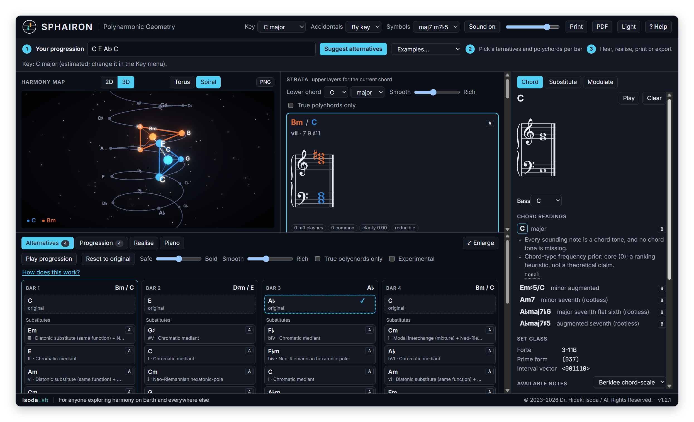</p>

4. **+ Bar** adds the polychord as a new bar; **Use in bar N** sets or replaces the upper layer of the selected bar. **Why** shows the reasons and the notes available over both layers.

### Tutorial 3: Give the whole progression an upper layer

1. Open the **Progression** tab. Each bar shows its chord; **⇄** replaces a bar's upper layer (it opens that bar's alternatives), **⊖** removes it, **×** removes the bar. **Remove upper layers** removes them all and keeps the chords.
2. Choose a **Strategy** and press **Generate upper layer**:
   - *Planing*: the upper layer moves in parallel at a fixed interval (Persichetti).
   - *Pedal*: one chord is held below while the progression moves above it.
   - *Bitonal* (choose the upper key), *Tritone* (the key a tritone away), *Mode-bound*, *Neo-Riemannian*.
   - *Phasing* (experimental): an upper loop of a different length.
3. The curves show **tension** (red) and **clarity** (dashed) bar by bar. The notation is part-written (**Voicing: Voice-led**); choose *Close position* to stack each chord from its root instead.

   <p align="center">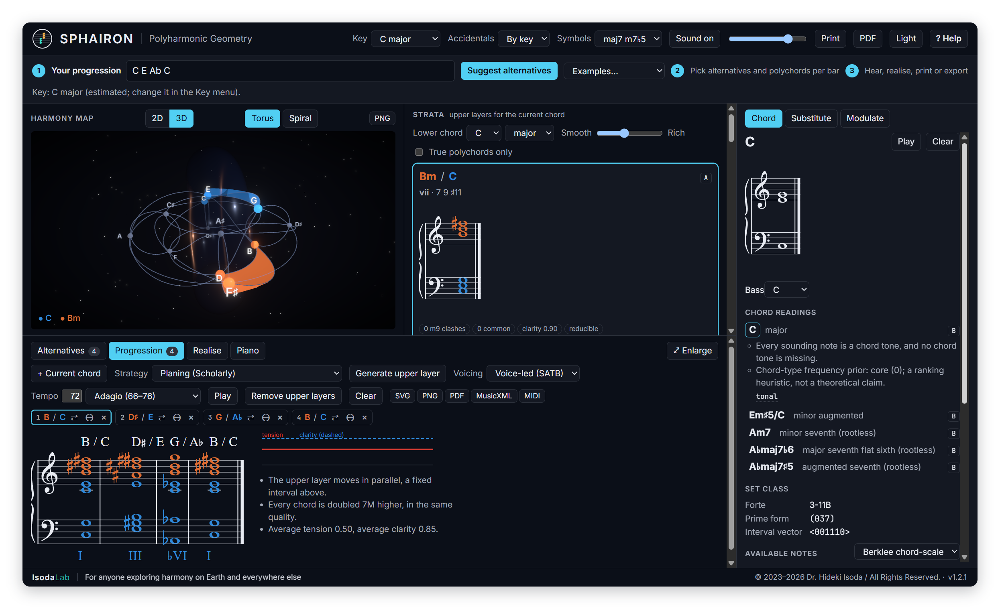</p>

### Tutorial 4: Hear it as music (Realise)

Open **Realise** and press **⤢ Enlarge** for room. Every view starts from the **best** arrangement (★); the **Arrangement** row offers other arrangements that keep every rule: the melody from the 3rd, 5th or root of the first chord, close or open position, or a smoother bass with inversions. An option that gives the same result as another says so.

- **Voices.** The progression part-written in four voices (and three for an upper layer), with the **voice-leading check** underneath. A green check means no rule is broken.

  <p align="center">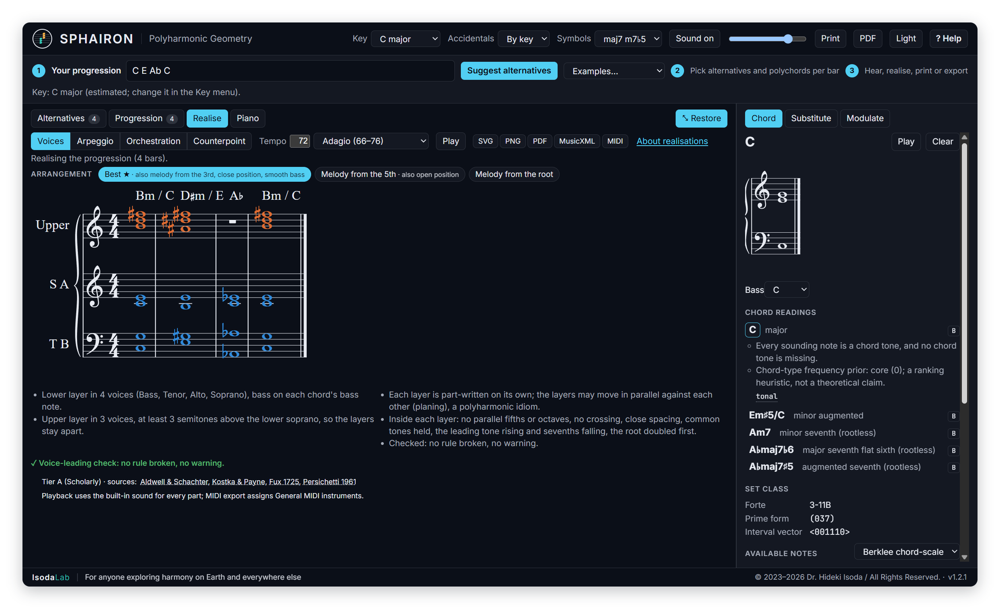</p>

- **Orchestration.** Choose a **Scoring**: *Winds over strings* and *Strings over brass* give each layer its own instrument family; the quartets blend everything into one choir. Each instrument plays one voice of the arrangement in its practical range. The score is in C (sounding pitch).
- **Arpeggio.** A playable piano part: each hand stays within an octave, low basses are open octaves, the left hand stays below the right. Choose the right-hand figure (rising, falling, rise-and-fall, Alberti, repeated chord), the left hand, and eighths or sixteenths.
- **Bass line** (Arpeggio and Orchestration): keep the voice-led bass, or choose a moving bass: *Root–fifth*, *Arpeggio*, *Passing (stepwise)*, *Walking (jazz)*, *Octaves (driving eighths)* or *Tonic pedal*. In the orchestra the moving bass goes to the lowest instrument, in the register of a bass voice (the double bass an octave lower, written an octave above its sound as usual).

  <p align="center">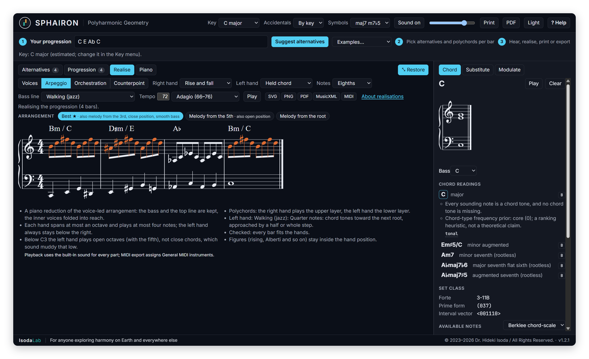</p>

- **Counterpoint.** A melody over the harmony under Fux's rules (first species: one note per bar; second species: two). The **Melody** row offers other lines, each starting on a different note of the first chord.

  <p align="center">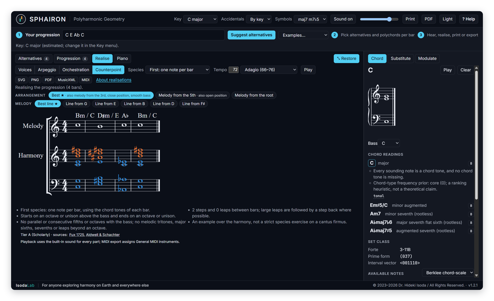</p>

Press **Play** to hear any view. To start somewhere else, **click a note, chord or bar in the score**: the button becomes *Play from bar 2, beat 3*, and playback starts there (click the note again to start from the beginning). While it plays, the bar is marked in the score and the **harmony map follows the music**, lighting the chord and the notes sounding in 2D and 3D. **Tempo**: type a value, or scroll on the number to step through the traditional metronome markings. **MIDI** and **MusicXML** export the view.

### Tutorial 5: Substitutions and modulations for one chord

- **Substitute** (right): chords that can replace the current chord, ranked by voice leading, function and the Safe–Bold setting, each with notation and reasons.

  <p align="center">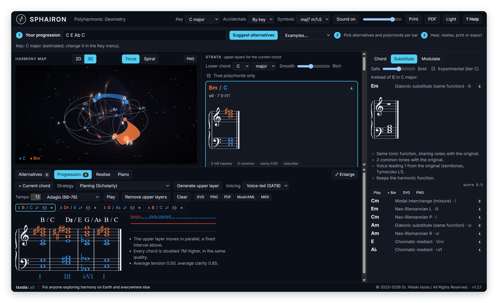</p>

- **Modulate**: choose a target key. Routes (pivot chord, ii–V into the new key, applied dominant, common tone, enharmonic, direct) are ranked by key distance, pivot quality and voice leading, and shown with both Roman-numeral readings, notation and playback.

  <p align="center">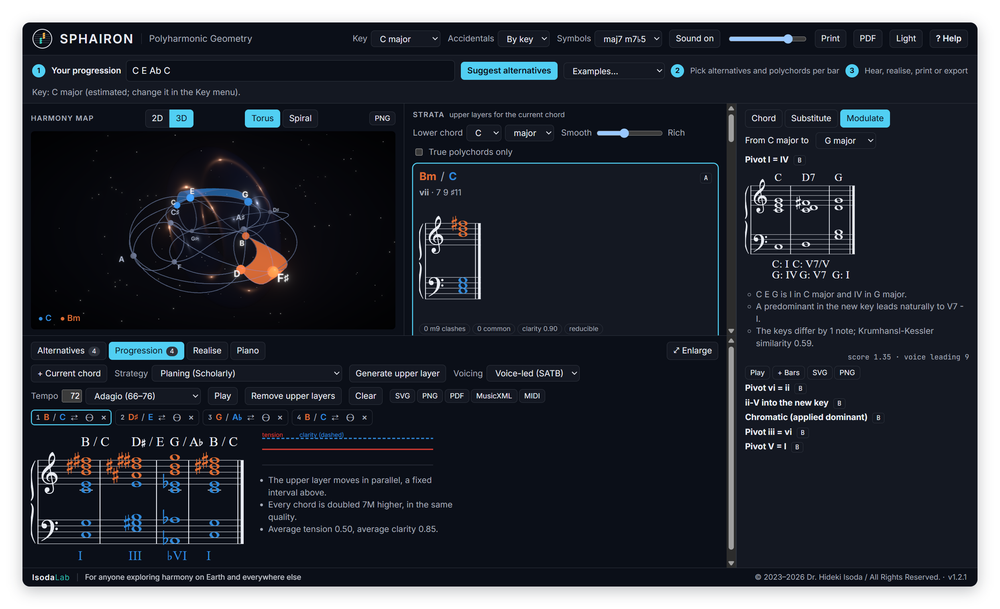</p>

### Tutorial 6: Print and export

- **Print** and **PDF** (top bar) make an A4 sheet: the current polychord with its analysis, the upper layers for the current chord, the progression, and the realisation you are viewing. Scores are black.

  <p align="center">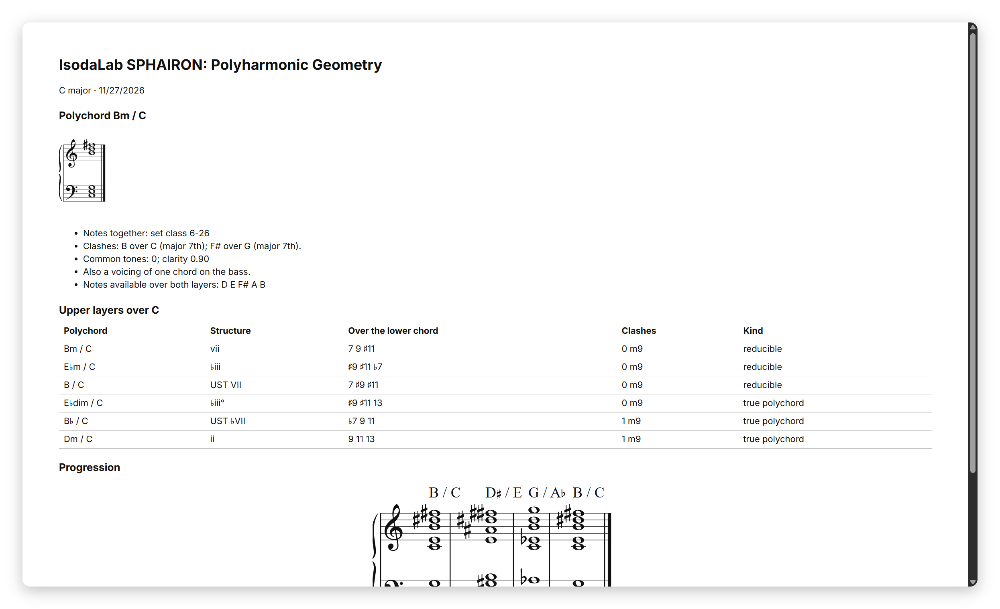</p>

- Every score has **SVG** (vector, sharp at any size), **PNG** (four times screen resolution), **MusicXML** (opens in Dorico, Finale, MuseScore and Sibelius) and, for progressions and realisations, **MIDI** (one track per layer or instrument, with General MIDI instruments). Maps export as SVG (2D) or PNG (3D).

### Tutorial 7: Play from a MIDI keyboard

Connect a MIDI keyboard (before or after starting SPHAIRON) and open the **Piano** tab: **MIDI in** lists the inputs. Play a chord and it becomes the current chord; it stays selected after you let go, so you can study it, ask Strata for upper layers, or add it to the progression with **+ Current chord** (Progression tab).

## Concepts

| Term | Meaning |
|---|---|
| **Polychord** | Two or more chords sounding together in separate registers, written upper over lower: *D / C* is D major over C major (Persichetti). |
| **Layer** | One chord of a polychord; the lower layer is blue, the upper orange. |
| **Upper structure (UST)** | A major triad over a chord, named by its root's degree above the lower root: *UST II* over C7 is D major (9, ♯11, 13) (Levine). |
| **Clash** | An upper note a half step (plus octaves) above a lower note: the sharpest friction between layers (*m9*). |
| **Clarity** | 0–1: how separately the layers are heard. A SPHAIRON ranking measure, not a published one. |
| **Reducible / true polychord** | Reducible: all the notes also form one chord on the bass (*Bm / C* is Cmaj7♯11). True: no single chord has exactly these notes. |
| **Tiers** | **A** scholarly (published research), **B** pedagogy (established teaching), **C** experimental (popular or contested; off unless *Experimental* is on). |
| **Voice-leading check** | After every arrangement SPHAIRON checks it again against the rules and lists any error or warning. |

The complete glossary, the rules behind every suggestion and the full source list are in the app (**? Help**).

<p align="center">
  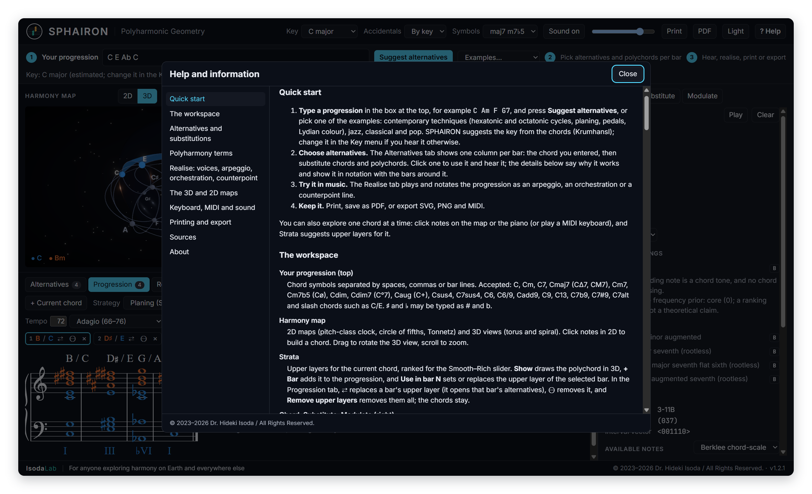
</p>

## Sources

Every suggestion names its sources. The main ones: Hook, *Exploring Musical Spaces: A Synthesis of Mathematical Approaches* (2023); Tymoczko, *A Geometry of Music* (2011); Cohn, "Neo-Riemannian Operations…" (1997) and *Audacious Euphony* (2012); Persichetti, *Twentieth-Century Harmony* (1961); Messiaen, *Technique de mon langage musical* (1944); Forte, *The Structure of Atonal Music* (1973); Bernardes et al., "A multi-level tonal interval space…" (2016); Levine, *The Jazz Piano Book* (1989) and *The Jazz Theory Book* (1995); Nettles & Graf, *The Chord Scale Theory & Jazz Harmony* (1997); Aldwell, Schachter & Cadwallader, *Harmony and Voice Leading* (5th ed., 2019); Kostka, Payne & Almén, *Tonal Harmony* (8th ed., 2018); Fux, *Gradus ad Parnassum* (1725; trans. Mann, 1965); Krumhansl & Kessler (1982) and Krumhansl, *Cognitive Foundations of Musical Pitch* (1990); Adler, *The Study of Orchestration* (4th ed., 2016). Every reference was checked against publisher and library records; Help → Sources lists them all. Tables such as Forte names and prime forms are generated with music21, not typed by hand.

## Privacy

SPHAIRON collects no data. It makes no network connections, has no analytics or telemetry, and needs no account, registration or license key. It writes only what you save or export, plays sound and reads MIDI only on your own computer, and remembers one setting (the colour theme) on your computer.

## License

SPHAIRON is **freeware**: free for personal, educational and commercial use on any number of computers. Music you write with it, and everything it exports, is entirely yours. You're welcome to share the unmodified packages with anyone, free of charge, with the license and copyright notice intact. It is not open source. The full terms are in [LICENSE.txt](LICENSE.txt).

Built with Electron, React, three.js, Tone.js and tonal; music notation by [Verovio](https://www.verovio.org) (LGPL-3.0, included unmodified and replaceable; see THIRD_PARTY_NOTICES.md in the package); Bravura, Inter and JetBrains Mono fonts (SIL Open Font License 1.1). Every component and its license is listed in THIRD-PARTY-LICENSES.txt in the package. Windows is a trademark of Microsoft Corporation; macOS of Apple Inc.; Linux is a registered trademark of Linus Torvalds.

## About

SPHAIRON is an ongoing research project of Dr. Hideki Isoda at Texas Tech University, begun in 2023 and inspired especially by Julian Hook's *Exploring Musical Spaces: A Synthesis of Mathematical Approaches* (Oxford University Press, 2023) and Dmitri Tymoczko's *A Geometry of Music* (Oxford University Press, 2011). It is free for composers, arrangers, performers, educators, students and researchers worldwide.

## Name

SPHAIRON comes from the Greek *sphaira* (sphere), echoing the "music of the spheres" and the 3D geometry at the heart of the tool.

## Transparency

SPHAIRON was developed by Dr. Hideki Isoda. Every rule implemented in its music theory engine has undergone AI-assisted validation against music21 and the cited theoretical references, followed by review by Dr. Isoda. Each suggestion is accompanied by its theoretical rationale, supporting references and authority tier, ensuring transparency and enabling users to independently evaluate and verify the underlying reasoning.

<sub>© 2023–2026 Dr. Hideki Isoda / All Rights Reserved.</sub>
